<p align="center">
  
</p>

<h1 align="center">Packet Picnic</h1>

<p align="center">
  A modern, full-stack file sharing platform built for fast and simple file uploads.
</p>

<p align="center">
  Upload files, store them securely, manage them from your dashboard, and share them instantly with unique links.
</p>

---

## ✨ Features

* 📤 **File Uploads** — Upload files directly to cloud storage.
* ☁️ **Cloudinary Storage** — Store uploaded files securely using Cloudinary.
* 🔗 **Shareable Links** — Generate a unique link for every uploaded file.
* 📥 **File Downloads** — Download shared files through secure generated URLs.
* 🔐 **Authentication** — Google authentication with protected user-specific resources.
* 📊 **File Dashboard** — View, search, sort, and manage uploaded files.
* 🗑️ **Trash Management** — Move files to trash and restore them when needed.
* ❌ **Permanent Deletion** — Permanently remove files from Cloudinary and MongoDB.
* 📱 **Responsive UI** — Clean interface designed for desktop and mobile screens.
* ⚡ **Fast Frontend** — Built with React, Vite, TypeScript, and Tailwind CSS.
* 🔒 **Server-Side Secrets** — Sensitive Cloudinary credentials and operations remain on the backend.

---

## 🛠️ Tech Stack

### Frontend

* React
* TypeScript
* Vite
* Tailwind CSS
* shadcn/ui
* React Router
* Axios
* Lucide React
* Sonner

### Backend

* Node.js
* Express
* TypeScript
* MongoDB
* Mongoose
* Cloudinary
* JWT
* Zod
* Nanoid

---

## 🏗️ Architecture

```text
┌─────────────────────────┐
│       React Client      │
│   Vite + TypeScript     │
└────────────┬────────────┘
             │
             │ REST API
             ▼
┌─────────────────────────┐
│    Express Backend      │
│      TypeScript         │
└───────┬─────────┬───────┘
        │         │
        ▼         ▼
 ┌──────────┐ ┌────────────┐
 │ MongoDB  │ │ Cloudinary │
 │ Metadata │ │   Files    │
 └──────────┘ └────────────┘
```

The frontend handles the user interface and file-management experience, while the backend manages authentication, authorization, file metadata, Cloudinary signatures, and protected file operations.

---

## 📂 Project Structure

The project is organized as a client-server monorepo:

```text
packet-picnic/
│
├── client/
│   ├── public/
│   ├── src/
│   │   ├── api/
│   │   ├── components/
│   │   ├── hooks/
│   │   ├── layout/
│   │   ├── lib/
│   │   ├── pages/
│   │   ├── context/
│   │   ├── types/
│   │   ├── utils/
│   │   ├── App.tsx
│   │   └── main.tsx
│   │
│   ├── package.json
│   └── vite.config.ts
│
├── server/
│   ├── src/
│   │   ├── config/
│   │   ├── controllers/
│   │   ├── middlewares/
│   │   ├── models/
│   │   ├── routes/
│   │   ├── schemas/
│   │   ├── utils/
│   │   ├── app.ts
│   │   └── server.ts
│   │
│   ├── package.json
│   └── tsconfig.json
│
└── README.md
```

> The structure above highlights the main application directories rather than listing every individual component and utility file.

---

## 🚀 Getting Started

### 1. Clone the repository

```bash
git clone https://github.com/abmdevx/packet-picnic.git

cd packet-picnic
```

### 2. Install dependencies

Install dependencies for both the frontend and backend:

```bash
cd client
npm install

cd ../server
npm install
```

### 3. Configure environment variables

Create a `.env` file inside both `client` and `server`.

### Client

```env
VITE_API_URL=http://localhost:8000/api/v1

VITE_CLOUDINARY_CLOUD_NAME=your_cloud_name
VITE_CLOUDINARY_API_KEY=your_api_key
```

### Server

```env
PORT=8000

CLIENT_URL=http://localhost:5173

MONGODB_URI=your_mongodb_connection_string

CLOUDINARY_CLOUD_NAME=your_cloud_name
CLOUDINARY_API_KEY=your_api_key
CLOUDINARY_API_SECRET=your_api_secret

JWT_SECRET=your_jwt_secret
```

> **Important:** Never expose `CLOUDINARY_API_SECRET`, `JWT_SECRET`, or other server-side secrets in the frontend.

---

## ▶️ Running the Project

### Start the backend

```bash
cd server
npm run dev
```

The API will run at:

```text
http://localhost:8000
```

### Start the frontend

Open another terminal:

```bash
cd client
npm run dev
```

The frontend will be available at:

```text
http://localhost:5173
```

---

## 🔄 How File Upload Works

```text
User
  │
  ▼
Select File
  │
  ▼
React Client
  │
  │ Request upload signature
  ▼
Express Backend
  │
  │ Generate signed request
  ▼
Cloudinary
  │
  │ Store file
  ▼
React Client
  │
  │ Send uploaded file metadata
  ▼
Express Backend
  │
  │ Save metadata
  ▼
MongoDB
  │
  ▼
Unique Share Link
```

Each uploaded file receives a unique identifier generated with `nanoid`.

Example:

```text
http://localhost:5173/files/abc123xyz
```

---

## 🗑️ Trash & File Lifecycle

Packet Picnic uses a soft-delete approach for normal deletion.

```text
Active File
    │
    │ Delete
    ▼
  Trash
    │
    ├───────────────┐
    │               │
    │ Restore       │ Permanent Delete
    ▼               ▼
Active File     Cloudinary
                    │
                    ▼
                 MongoDB
```

When a file is moved to trash:

* The file remains in Cloudinary.
* Its MongoDB record remains.
* `isTrashed` is set to `true`.
* The file is hidden from the main dashboard.

When a file is restored:

* `isTrashed` is set back to `false`.
* The file becomes visible again in the dashboard.

When permanently deleted:

* The Cloudinary asset is deleted.
* The MongoDB metadata is deleted.
* The operation cannot be undone.

---

## 🔐 Authentication & Security

Packet Picnic protects user-specific resources through authentication and authorization.

Security measures include:

* Google authentication.
* JWT-based authentication.
* Protected dashboard APIs.
* Authenticated file ownership.
* Server-side Cloudinary signatures.
* Server-side Cloudinary deletion.
* Server-side Cloudinary API secret.
* Zod request validation.
* Unique file identifiers using `nanoid`.
* User ownership checks before modifying or permanently deleting files.

The backend verifies that a file belongs to the authenticated user before allowing protected file-management operations.

---

## 📡 API Overview

### Authentication

| Method | Endpoint              | Description                |
| ------ | --------------------- | -------------------------- |
| `POST` | `/api/v1/auth/google` | Authenticate with Google   |
| `GET`  | `/api/v1/auth/me`     | Get the authenticated user |

### File Upload & Sharing

| Method | Endpoint                           | Description                          |
| ------ | ---------------------------------- | ------------------------------------ |
| `POST` | `/api/v1/files/upload/signature`   | Generate Cloudinary upload signature |
| `POST` | `/api/v1/files`                    | Save uploaded file metadata          |
| `GET`  | `/api/v1/files/:uniqueId`          | Get shared file information          |
| `GET`  | `/api/v1/files/:uniqueId/download` | Generate download URL                |

### File Management

| Method   | Endpoint                            | Description                           |
| -------- | ----------------------------------- | ------------------------------------- |
| `GET`    | `/api/v1/files/get-all-files`       | Get authenticated user's active files |
| `GET`    | `/api/v1/files/get-trash-files`     | Get authenticated user's trash files  |
| `PATCH`  | `/api/v1/files/update-trash-status` | Move files to trash or restore them   |
| `DELETE` | `/api/v1/files/permanent`           | Permanently delete files              |

> Protected endpoints require authentication.

---

## 🎨 User Interface

Packet Picnic provides a clean and minimal interface focused on quick file management and sharing.

### Main areas

* 🏠 Landing page
* 🔐 Authentication
* 📊 Dashboard
* 📁 My Files
* 🔗 Shared File Page
* 🗑️ Trash
* 📤 Upload Dialog
* 📱 Responsive navigation

The dashboard supports:

* List view
* Grid view
* File search
* File sorting
* File upload
* File download
* Share-link copying
* Trash management
* File restoration
* Permanent deletion

---

## ☁️ Cloudinary Integration

Packet Picnic uses Cloudinary for file storage.

The upload process uses a server-generated signature so that the Cloudinary API secret never needs to be exposed to the frontend.

Cloudinary stores the uploaded asset while MongoDB stores the associated metadata, including:

```text
originalName
storedName
mimeType
size
storageUrl
cloudinaryPublicId
cloudinaryResourceType
uniqueId
downloadCount
owner
isTrashed
trashedAt
```

---

## 📊 File Metadata

Each uploaded file is associated with metadata stored in MongoDB.

This allows Packet Picnic to provide:

* File ownership
* File search
* File sorting
* Download statistics
* Trash management
* File restoration
* Permanent deletion
* Unique sharing links

---

## 📌 Project Status

**In Development**

Packet Picnic is an actively developed full-stack project built for learning, experimentation, and portfolio development.

Current functionality includes:

* Authentication
* File uploads
* Cloudinary storage
* File sharing
* File downloads
* Dashboard
* Search and sorting
* List and grid views
* Trash management
* File restoration
* Permanent deletion
* Responsive UI

---

## 📄 License

This project is currently developed for educational and portfolio purposes.